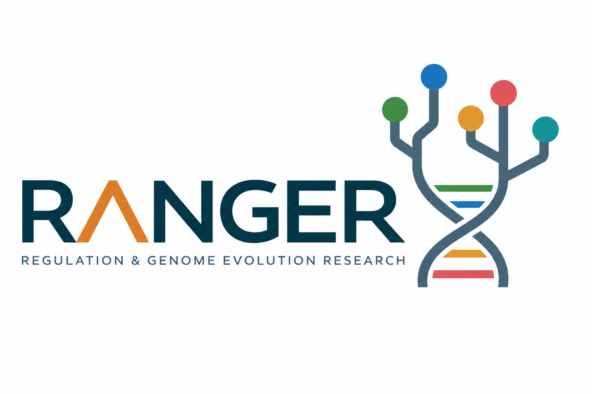
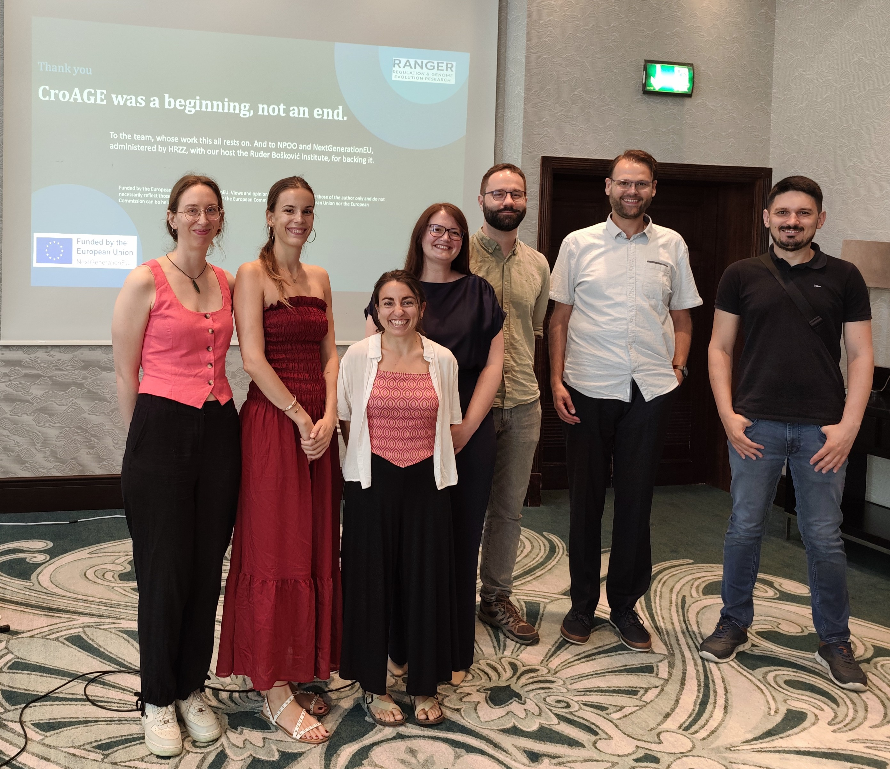

# **Welcome to the RANGER Group webpage**

The **Regulation & Genome Evolution Research** group focuses on understanding the dynamic gene expression of proliferative stages and tissues in organisms across the tree of life. The group was established in 2024 at the [Ruđer Bošković Institute (RBI)](https://www.irb.hr/) within the Laboratory for Computational Biology and Translational Medicine, Division of Computing and Data Science.

 
 

At **EMBO Scientists’ Forum (ESF) 2026** in Sheraton Dubrovnik Riviera Hotel [October 28-30, 2026].

 
 

On 30 June 2026, we had the pleasure of hosting the **CroAGE Project Final Conference** in Zagreb.

 
 

Group retreat in Zagreb.

