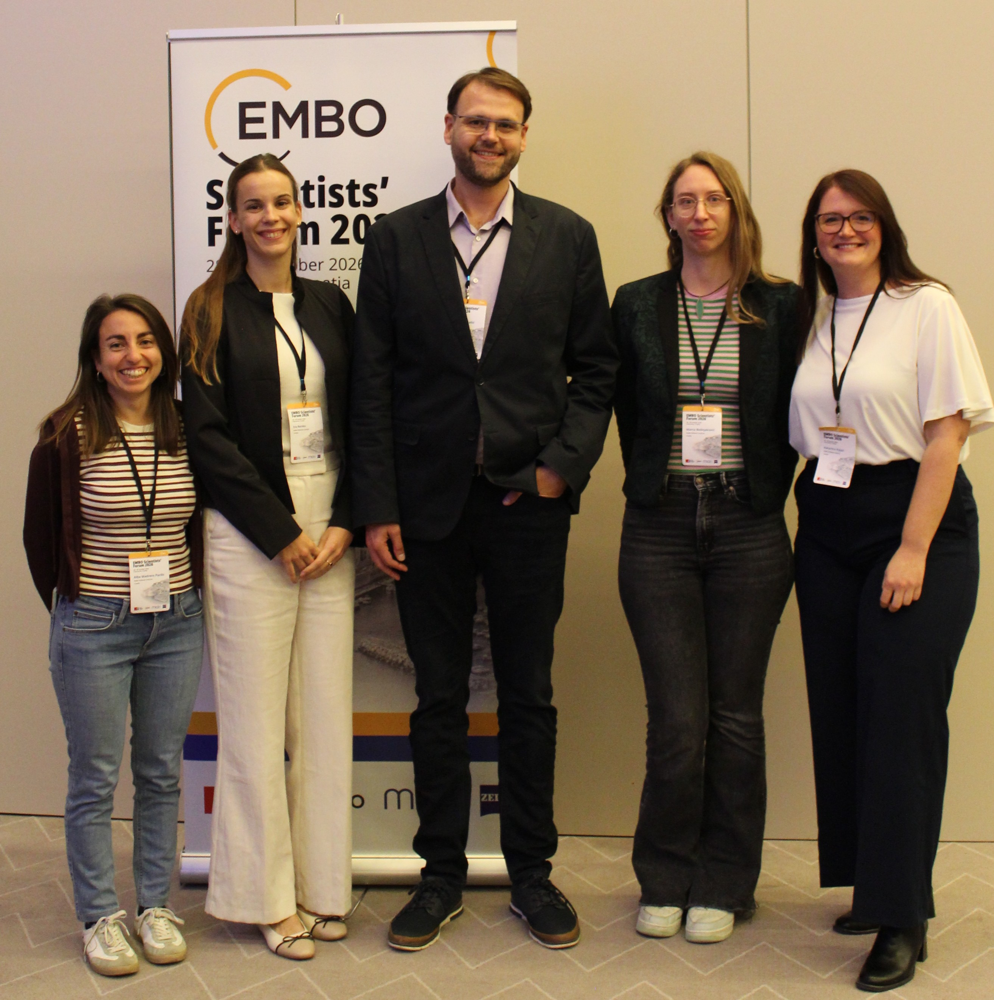

# **Welcome to the RANGER Group webpage**

The **Regulation & Genome Evolution Research** group focuses on understanding the dynamic gene expression of proliferative stages and tissues in organisms across the tree of life. The group was established in 2024 at the [Ruđer Bošković Institute (RBI)](https://www.irb.hr/) within the Laboratory for Computational Biology and Translational Medicine, Division of Electronics.

